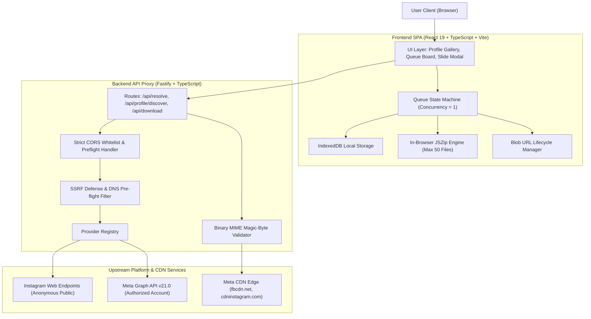

# Snapora ⚡

> **Snapora is an open-source utility for discovering and downloading accessible public Instagram media, with additional account-owned media discovery through authorized Meta integration.**

🌐 **Live Deployment**: [https://snapora-1r3i.onrender.com/](https://snapora-1r3i.onrender.com/) (Hosted on Render)

[](CHANGELOG.md)
[](https://github.com/buildwithtime/snapora/actions)
[](LICENSE)
[](https://www.typescriptlang.org/)
[](https://react.dev/)
[](https://fastify.dev/)
[](https://nodejs.org/)

---

> [!IMPORTANT]
> **LEGAL DISCLAIMER & NON-AFFILIATION NOTICE**:
> Snapora is an independent, community-driven open-source software project. It is **not** affiliated with, authorized, maintained, sponsored, or endorsed by Instagram, Meta Platforms, Inc., or any of their affiliates or subsidiaries. All product and company names are trademarks™ or registered® trademarks of their respective holders. Use of them does not imply any affiliation with or endorsement by them.
>
> Snapora operates strictly under a **Zero-Credential** architectural model. It does **not** bypass platform authentication, does **not** harvest or store session cookies, and does **not** scrape private profiles. Users are solely responsible for complying with Instagram's Terms of Service and respecting the copyright, moral rights, and intellectual property rights of original media creators.

---

## 📖 Product Overview

Snapora is an open-source media utility engineered for reliability, safety, and transparency. It pairs a high-performance React 19 single-page application with a stateless Node.js Fastify backend proxy to provide:

* **Interactive Profile Discovery**: Browse and selectively download public posts, Reels, and carousels from public creator profiles.
* **Deterministic Sequential Queue**: Process batches of media links sequentially with concurrency control (concurrency = 1) and pause/resume/retry state management.
* **In-Browser Bulk Archiving**: Package selected media into uncompressed ZIP archives entirely within the browser via JSZip, avoiding server-side data retention.
* **Local Persistence**: Queue state and job history persist in client-side IndexedDB, ensuring your data never leaves your device.
* **Defense-in-Depth Security**: Strict socket-level DNS pre-flight SSRF protection, binary MIME magic-byte verification, and production CORS origin isolation.

---

## ✨ Core Capabilities

### 1. Instagram Profile Gallery & Selective Downloads (v0.3.0)
- **Profile Discovery**: Input any public Instagram profile link (e.g. `instagram.com/creator/`) or `@username` handle.
- **Interactive Media Grid**: Displays posts, Reels, and carousel albums with post counts, follower badges, and account biographies.
- **Instant Media Type Filters**: Filter discovered items on the fly by `Photos`, `Videos`, or `Carousels`.
- **Selective Batch Toolbar**: Persistently toggle selection (`Select All`, `Select None`, `Invert`) across paginated cursor sessions.
- **Carousel Inspection Modal**: Preview individual carousel slides and selectively download single slides or enqueue complete albums into the queue.
- **Memory-Safe Guardrails**: Enforces ceilings of up to 500 discoverable items per profile session (`MAX_PROFILE_ITEMS = 500`) and up to 50 media files per browser ZIP archive (`MAX_ZIP_ITEMS = 50`, `MAX_ZIP_TOTAL_BYTES = 500 MB`).

### 2. Sequential Multi-URL Queue
- Input multiple Instagram links at once (newline-separated or comma-delimited).
- Concurrency-controlled sequential queue (concurrency = 1) prevents browser tab freezes and respects rate limits.
- Pause, resume, retry failed items, or cancel active downloads with full state tracking.

### 3. Streaming Media Delivery
- Single-pass Fastify download proxy (`GET /api/download`) pipes initial validation chunks and remaining upstream stream without memory bloat.
- Payload ceiling of up to 150 MB (`MAX_RESPONSE_SIZE_BYTES = 157286400`) accommodates high-definition video Reels.
- Client-side Blob URL lifecycle manager (`blobLifecycle.ts`) prevents premature URL revocation and browser memory leaks.

### 4. Modular Provider Architecture (`IMediaProvider`)
- **`PublicWebMediaProvider` (`public` — Default)**: Resolves supported public Instagram posts, Reels, and profile media without requiring API keys.
- **`MockProvider` (`mock`)**: Offline simulated deterministic fixtures for unit testing, continuous integration, and static demo deployments.
- **`InstagramOEmbedProvider` (`oembed`)**: Official Meta Graph API v21.0 post embed frames, author metadata, and thumbnail previews.
- **`AuthorizedAccountMediaProvider` (`authorized`)**: Official Meta Business Login OAuth 2.0 integration for creator/business accounts to access their own original media (`/me/media`).
- **`DirectMediaUrlProvider` (`direct`)**: Ingests direct Meta CDN URLs with DNS pre-flight checks and cryptographic token validation.

---

## ⚠️ Access Boundaries & Realistic Expectations

Please understand the platform boundaries under which Snapora operates:

### 1. Anonymous Public-Media Access Boundaries
- **No Guaranteed Universal Access**: Instagram dynamically serves unauthenticated React single-page application shells (~507 KB) or login walls for many posts, Reels, and profiles when queried without active session cookies.
- **Diagnostic Classification**: When Instagram challenges anonymous web access, Snapora classifies the response as `LOGIN_WALL_ENCOUNTERED` (HTTP 403) and displays actionable user guidance rather than masking it as a generic crash.
- **Upstream Rate Limiting (HTTP 429)**: Instagram may throttle unauthenticated requests originating from shared hosting or cloud IP addresses. Snapora incorporates retry mechanisms and socket-level timeouts.

### 2. Authorized Meta Account-Owned Media Access
- **First-Party Media Scope**: Connecting an official Meta User Access Token via OAuth 2.0 strictly unlocks media belonging to the authenticated user's **own managed creator or business account** (`/me/media`).
- **No Third-Party Access**: Official Meta APIs do not permit downloading content from arbitrary third-party accounts.

### 3. Strictly Unsupported Access
- **Private Profiles & Stories**: Snapora **cannot and will not** download posts, Reels, or stories from private Instagram accounts.
- **No Login-Wall Circumvention**: Snapora strictly complies with platform security boundaries. It does **not** harvest user session cookies, does **not** bypass CAPTCHAs, and does **not** route traffic through residential proxy networks.

---

## 🏗️ Architecture & Technology Stack

Snapora uses a decoupled architecture designed for static deployment and stateless safety:



### Technology Stack

| Layer | Technologies | Key Packages & Standards |
| :--- | :--- | :--- |
| **Frontend** | React 19, TypeScript 5.6, Vite 6 | `idb` (IndexedDB), `jszip` (ZIP packaging), CSS3 Variables |
| **Backend** | Node.js 22 LTS / 24, Fastify 4, TypeScript 5.6 | `@fastify/cors`, `@fastify/rate-limit`, `@fastify/static`, `zod` |
| **Testing** | Vitest 2.1, React Testing Library, JSDOM | 325 automated tests across 25 unit/integration suites |
| **Tooling** | npm workspaces, ESLint, TypeScript Project References | Zero-downtime Render deployment topology |

---

## 🔌 API Reference

The backend exposes a stateless REST API designed for post resolution, profile discovery, provider listing, and streaming media proxying.

### 1. Resolve Single Post or Reel
- **Route**: `POST /api/resolve`
- **Authentication**: None required for public media. For authorized creator accounts, supply a Meta token in the request body (`userAccessToken`) or via header `Authorization: Bearer <token>`.
- **Request Body (JSON)**:
  ```json
  {
    "url": "https://www.instagram.com/p/SHORTCODE/",
    "provider": "public",
    "userAccessToken": "optional-meta-token"
  }
  ```
- **Success Response (200 OK)**:
  ```json
  {
    "ok": true,
    "shortcode": "SHORTCODE",
    "media": [
      {
        "id": "media_1",
        "type": "image",
        "url": "https://scontent.cdninstagram.com/...",
        "filename": "snapora_media.jpg",
        "downloadable": true
      }
    ],
    "provider": "public",
    "caption": "Post caption text",
    "username": "creator"
  }
  ```
- **Error Codes**: `INVALID_REQUEST` (400), `UNSUPPORTED_URL` (400), `AUTHENTICATION_REQUIRED` (401), `PRIVATE_ACCOUNT` (403), `LOGIN_WALL_ENCOUNTERED` (403), `POST_NOT_FOUND` (404), `EXPIRED_MEDIA_URL` (410), `RATE_LIMITED` (429, includes `Retry-After` header), `PAGE_FETCH_FAILED` (502), `PROVIDER_NOT_CONFIGURED` (503).

### 2. Discover Profile Media Gallery
- **Route**: `POST /api/profile/discover`
- **Authentication**: None required for public profiles. Optional Bearer token for authorized provider.
- **Request Body (JSON)**:
  ```json
  {
    "url": "https://www.instagram.com/username/",
    "cursor": "optional-pagination-cursor-token",
    "provider": "public",
    "userAccessToken": "optional-meta-token"
  }
  ```
- **Success Response (200 OK)**:
  ```json
  {
    "ok": true,
    "profile": {
      "username": "creator",
      "fullName": "Creator Name",
      "biography": "Bio text",
      "postCount": 142,
      "followersCount": 12500
    },
    "items": [
      {
        "id": "post_1",
        "shortcode": "SHORTCODE",
        "type": "carousel",
        "displayUrl": "https://...",
        "slideCount": 4,
        "caption": "Album caption"
      }
    ],
    "pagination": {
      "hasMore": true,
      "nextCursor": "cursor_token"
    }
  }
  ```
- **Error Codes**: `INVALID_REQUEST` (400), `INVALID_URL` (400), `UNSUPPORTED_URL` (400), `AUTHENTICATION_REQUIRED` (401), `PRIVATE_ACCOUNT` (403), `LOGIN_WALL_ENCOUNTERED` (403), `CONTENT_UNAVAILABLE` (404), `RATE_LIMITED` (429), `PROVIDER_ERROR` (500), `UNSUPPORTED_RETRIEVAL_METHOD` (503).

### 3. Media Download Stream
- **Route**: `GET /api/download`
- **Authentication**: None.
- **Query Parameters**:
  - `url` (string, required): Direct upstream media URL to stream.
  - `filename` (string, optional): Desired output filename.
  - `expectedType` (string, optional): `'image' | 'video'`.
- **Response Headers**:
  - `Content-Type`: `video/mp4`, `image/jpeg`, `image/webp`, or `application/octet-stream`
  - `Content-Disposition`: `attachment; filename="sanitized_filename.ext"`
  - `Content-Length`: Total verified byte size
  - `Cache-Control`: `no-store, no-cache, must-revalidate`
- **Error Codes**: `INVALID_REQUEST` (400), `INVALID_URL` (400), `SSRF_BLOCKED` (400), `EXPIRED_MEDIA_URL` (410), `FILE_TOO_LARGE` (413, when payload exceeds 150 MB ceiling), `MEDIA_VALIDATION_FAILED` (422, binary magic-byte mismatch), `STREAM_INTERRUPTED` (502).

### 4. Registered Media Providers
- **Route**: `GET /api/providers`
- **Authentication**: None.
- **Success Response (200 OK)**:
  ```json
  {
    "ok": true,
    "defaultProvider": "public",
    "providers": [
      {
        "id": "public",
        "name": "Public Web Resolver",
        "supportedMediaTypes": ["image", "video", "carousel"],
        "requiresAuthentication": false
      }
    ]
  }
  ```

### 5. Health Check Probes
- **Routes**: `GET /health` (load balancer health probe) and `GET /api/health`
- **Authentication**: None.
- **Success Response (200 OK)**:
  ```json
  {
    "ok": true,
    "service": "snapora-backend",
    "status": "healthy",
    "timestamp": "2026-10-31T14:43:00.000Z",
    "uptimeSeconds": 1234
  }
  ```

---

## 🚀 Getting Started

### Prerequisites
- [Node.js](https://nodejs.org/) `>= 22.x` (Recommended: Node.js 22 LTS or Node.js 24 LTS)
- [npm](https://www.npmjs.com/) `>= 10.x`
- [Git](https://git-scm.com/)

### Installation & Local Setup

1. **Clone the repository**:
   ```bash
   git clone https://github.com/buildwithtime/snapora.git
   cd snapora
   ```

2. **Install workspace dependencies**:
   ```bash
   npm install
   ```

3. **Configure environment variables**:
   ```bash
   cp .env.example .env
   ```

4. **Start local development servers**:
   ```bash
   # Starts frontend (:5173) and backend (:3001) concurrently
   npm run dev
   ```
   Open [http://localhost:5173](http://localhost:5173) in your browser.

---

## ⚙️ Environment Configuration

| Variable | Required | Default | Description |
| :--- | :---: | :---: | :--- |
| `PORT` | No | `3001` | TCP port assigned by cloud platforms (Render, Railway). |
| `HOST` | No | `0.0.0.0` | IP interface to bind to (`0.0.0.0` for container networks). |
| `NODE_ENV` | No | `development` | Set to `production` in production environments. |
| `DEFAULT_PROVIDER` | No | `public` | Provider: `public`, `mock`, `oembed`, `authorized`, `direct`. |
| `CORS_ORIGIN` | No | `https://snapora-1r3i.onrender.com` | Production CORS whitelist. Wildcards (`*`) are prohibited in production. |
| `CORS_PREVIEW_ORIGINS` | No | `""` | Comma-separated preview domains (e.g. Render PR previews). |
| `RATE_LIMIT_MAX` | No | `30` | Max requests per IP within the time window. |
| `RATE_LIMIT_WINDOW_MS` | No | `60000` | Sliding window duration in milliseconds (60 seconds). |
| `RESOLVER_TIMEOUT_MS` | No | `10000` | Network request timeout for upstream post resolution. |
| `MAX_RESPONSE_SIZE_BYTES`| No | `157286400` | Max allowable media stream size (150 MB). |
| `VITE_API_BASE_URL` | No | `""` | API base URL. Leave empty for unified single-service deployments. |

---

## 🧪 Testing & Code Quality

Snapora maintains a comprehensive quality test suite:

```bash
# Run unit & integration test suites across all workspaces (325 tests)
npm test

# Run TypeScript compilation checks across frontend and backend
npm run typecheck

# Run ESLint across all workspaces
npm run lint

# Verify production Vite bundle and backend tsc compilation
npm run build

# Verify diff whitespace and formatting integrity
git diff --check
```

---

## 🚢 Production Deployment

### Option A: Unified Single-Service Deployment (Recommended)
A single Node.js container or web service serves both the Fastify backend API (`/api/*`, `/health`) and the compiled static frontend SPA:
* **Zero CORS issues**: Frontend and API share the exact same origin.
* **Cost & resource efficiency**: Single server process, container, or web service.
* **Automatic Port Binding**: Automatically detects `PORT` provided by Render, Railway, or Fly.io.

```bash
npm run build
npm start
```

### Option B: Decoupled Multi-Service Deployment
* **Frontend**: Deploy `frontend/dist` to static CDN hosting (Cloudflare Pages, Vercel, Netlify, S3) with `VITE_API_BASE_URL=https://api.yourdomain.com`.
* **Backend**: Deploy `backend` to a Node.js web service with `CORS_ORIGIN=https://your-frontend-domain.com`.

---

## 🛡️ Security & Privacy Architecture

- **Zero Credential Collection**: Snapora never collects, stores, or handles user platform passwords, cookies, or session tokens.
- **Socket-Level SSRF Protection**: Custom HTTPS agent pre-resolves DNS records and inspects socket IP addresses, blocking all private RFC1918 subnets, loopback, link-local, multicast, and cloud metadata (`169.254.169.254`) across IPv4 and IPv6.
- **Strict Binary Validation**: Validates file magic bytes (JPEG SOI `FF D8 FF`, MP4 `ftyp` box, WebM `1A 45 DF A3` EBML header) and rejects HTML/JSON error pages before marking downloads complete.
- **CORS Hardening**: Strict production whitelisting, URL normalization via WHATWG URL standard, and explicit OPTIONS preflight handling with credentials.
- **Local Isolation**: All download queue state, item metadata, and media blobs reside solely in your browser's IndexedDB and memory.

---

## 📁 Repository Map

```
snapora/
├── .github/
│   ├── ISSUE_TEMPLATE/     # Structured bug report and feature request forms
│   ├── workflows/          # GitHub Actions CI and Release pipelines
│   ├── dependabot.yml      # Automated weekly dependency updates
│   └── pull_request_template.md
├── backend/                # Fastify REST API proxy
│   ├── src/
│   │   ├── config/         # Environment, CORS & allowlist configuration
│   │   ├── providers/      # IMediaProvider implementations (Public, Mock, OEmbed, Authorized, Direct)
│   │   ├── routes/         # API routes (/api/resolve, /api/profile, /api/download, /health)
│   │   └── utils/          # SSRF defenses, URL sanitizers, binary validator, error models
│   └── tsconfig.json
├── frontend/               # React 19 + TypeScript + Vite application
│   ├── src/
│   │   ├── components/     # ProfileGallery, QueueControls, JobItem, Modals
│   │   ├── context/        # ProfileGalleryContext, QueueContext state machines
│   │   ├── types/          # Queue, Profile, and Provider type definitions
│   │   └── utils/          # ZipDownloader, BlobLifecycle, ApiClient, Storage
│   └── vite.config.ts
├── docs/                   # Architecture, Deployment, Terms & Privacy documentation
├── CHANGELOG.md            # Structured release history (Keep a Changelog)
├── CONTRIBUTING.md         # Contributor guidelines and workflow
├── CODE_OF_CONDUCT.md     # Contributor Covenant v2.1
├── SECURITY.md             # Vulnerability disclosure policy
├── LICENSE                 # MIT License
└── README.md
```

---

## 🤝 Community & Contributing

Contributions are welcome! Please read our [CONTRIBUTING.md](CONTRIBUTING.md) guide and adhere to our [Code of Conduct](CODE_OF_CONDUCT.md).

For security disclosures, please review [SECURITY.md](SECURITY.md) and report privately via [GitHub Security Advisories](https://github.com/buildwithtime/snapora/security/advisories/new).

---

## 📄 License

Snapora is licensed under the [MIT License](LICENSE).
Copyright © 2026 Snapora Contributors.
